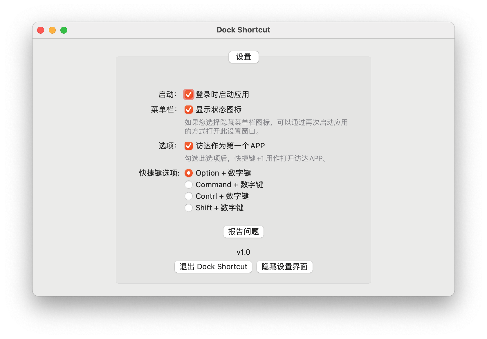

# Dock Shortcut

[ENGLISH](README.md)

使用热键来打开Dock中的应用程序。`option + 1` 打开Dock中的第一个应用程序，就像Linux和Windows那样。

## 特性

- 免费且开放源代码
- 支持在登录时启动
- 使用习惯在Linux和Window下保持一致

## 安装

从 <https://github.com/yi-ge/dock-shortcut/releases> 下载最新版的应用程序。

## 使用技巧

- 用 `Option + 1` 到 `Option + 0` 打开或隐藏 Dock 中对应的应用。调整 Dock 中的应用顺序后，快捷键会随之更新。
- 如果 macOS 要求批准登录时启动，可在 Dock Shortcut 设置中点击按钮，打开系统登录项设置。
- 隐藏菜单栏图标后，可在 Finder 中再次打开 Dock Shortcut，显示设置窗口。
- MacOS系统显示和隐藏Dock栏的快捷键是 `option + command + d`
